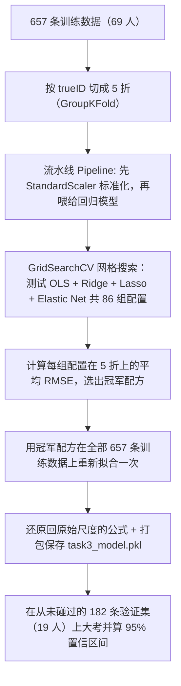

# Task 3 模型方法与训练全流程拆解（大白话版）

这篇文档专门拆解 [src/task3.py](../src/task3.py) 和 [task3.md](task3.md) 到底**用了什么统计/机器学习方法**，以及**模型是怎么一步步训练出来的**。

> **核心一句话：**
> 代码用的是**带惩罚项的线性回归家族**（OLS、Ridge、Lasso、Elastic Net），通过**按人分组的 5 折交叉验证**挑出最好的算法和惩罚力度，再在全部训练集上重训一次。最终胜出的是 **Lasso**，而且它觉得「探索阶段瞳孔大小」没啥帮助，直接把瞳孔权重砍成了 **0**。

---

## 一、先搞清楚：模型在学什么？（输入与输出）

模型的任务本质上就是**找一个数学公式**，根据你「以前考得怎么样」和「刚才学习时瞳孔有多大」，去猜你「马上要做的这一轮第 1 屏测验能得多少分」。

| 角色 | 字段名 | 人话解释 | 备忘 |
| --- | --- | --- | --- |
| **目标 `y`** | `actual` | 当前周期第 1 个决策屏幕的 `performance` 得分 | Paintings 和 Quotes 合并一起预测 |
| **输入特征 `X₁`** | `previous_performance` | 同一半场里，**上一轮**第 1 屏的得分 | 休息后重置，所以每半场第 1 轮没有上一轮，不进样本 |
| **输入特征 `X₂`** | `history_mean` | 同一半场里，**之前所有轮**第 1 屏的平均分 | — |
| **输入特征 `X₃`** | `pupil_explore` | 当前探索阶段（`phase=0`）的瞳孔中位数 | 已减掉每人最初 10 分钟基线；**纯历史对照组没有这一项** |

**两组人马严格分开（防作弊）：**
- **训练集（69 人，657 条记录）**：用来给模型「刷题学规律 + 调参数」。
- **固定验证集（19 人，182 条记录）**：锁在保险箱里，训练和调参时一眼都不准看，最后用来「一锤定音的大考」。
- **按人划分，绝不劈腿**：同一个人贡献的所有轮次，要么全在训练集，要么全在验证集。这样才能检验模型能不能预测**没见过的新人**，而不是靠背熟某个人的习惯作弊。

---

## 二、用了什么模型方法？

代码在 [`search_models`](../src/task3.py#L167-L206) 里一共对比了 **4 种线性回归模型**（外加 1 个不用训练的偷懒基准）。

### 0. 偷懒基准（`previous_cycle`）
连公式都不学，直接硬猜：**「这一轮分数 = 上一轮分数」**。用来当垫底参照物，证明正经训练的模型至少要比无脑复读上一轮强。

### 1. OLS（普通最小二乘线性回归，Ordinary Least Squares）
最经典、最直白的直线公式：

$$\hat{y} = b + w_1 \cdot X_1 + w_2 \cdot X_2 + w_3 \cdot X_3$$

- **做法**：不管三七二十一，调整截距 $b$ 和权重 $w_1, w_2, w_3$，让「所有训练题的预测误差平方和」越小越好。
- **缺点**：只要特征多或者数据里有噪声，它也会硬给噪声分配权重，容易学偏（过拟合）。

### 2–4. 三个带「偷懒惩罚（正则化）」的线性回归
为了防止模型乱给没用的特征分配权重，统计学家在 OLS 的误差后面加了一项**「惩罚分」**：

$$\text{总损失} = \text{预测误差} + \alpha \times \text{对权重大小的惩罚}$$

其中 $\alpha$（alpha）是**惩罚力度旋钮**：$\alpha$ 越大，模型就越不敢随便给特征高权重。代码里试了从 $10^{-4}$ 到 $10^4$ 共 **17 个等对数间隔的档位**。

根据惩罚方式不同，分成了三种方法：

| 模型 | 惩罚方式 | 大白话特点 | 本次试了多少组参数 |
| --- | --- | --- | --- |
| **Ridge（岭回归）** | **L2 惩罚**：惩罚权重的平方和（$\sum w_i^2$） | 会把不重要的特征权重**捏得很小**，但**不会变成 0**，所有线索多少留一点 | 17 个 `alpha` |
| **Lasso（套索回归）** | **L1 惩罚**：惩罚权重的绝对值和（$\sum \lvert w_i \rvert$） | **非常狠心**：一旦发现某个特征的贡献抵不上惩罚，**直接把它的权重削成 `0`**（自动踢掉废特征） | 17 个 `alpha` |
| **Elastic Net（弹性网）** | **L1 + L2 混合**：按比例 `l1_ratio` 把上面两种拼一起 | 既能把没用的特征削成 0，遇到相关特征时又比纯 Lasso 稳一点 | 17 个 `alpha` × 3 个 `l1_ratio`（0.1, 0.5, 0.9）= 51 组 |

---

## 三、模型到底是怎么一步步训练出来的？

整个训练流程在 [`run`](../src/task3.py#L250-L340) 和 [`search_models`](../src/task3.py#L167-L206) 里实现，可以拆成 **5 个标准步骤**：

### 第 1 步：把 69 个训练参与者分成 5 份（`GroupKFold`）
- 代码没有随机把 657 条记录打乱分成 5 份，而是用 `GroupKFold(n_splits=5)` **按 `trueID`（人）分组**。
- 每一折大约有 13–14 个人的全部记录。做验证时，用其中 4 组人训练，拿剩下 1 组「完全没见过的人」测试，轮流 5 次。
- **为什么要这样？** 如果同一个人第 3 轮在训练、第 4 轮在测试，模型就等于提前认识这个人了，算出来的误差会虚低（数据泄漏）。
- 对照组（`history_only`，只看历史）和实验组（`task3`，历史 + 瞳孔）**用的是完全一模一样的 5 折分法**，保证对比绝对公平。

### 第 2 步：把「标准化」焊死在流水线里（`Pipeline` + `StandardScaler`）
- 三个特征的数值范围差很多：`previous_performance` 和 `history_mean` 大概是几十，`pupil_explore` 往往是零点几。如果不拉到同一水平线，惩罚项 `alpha` 对大数字和小数字就不公平。
- `StandardScaler` 会把每个特征都变成**均值 0、标准差 1**（计算公式：$z = \frac{x - \text{均值}}{\text{标准差}}$）。
- **关键防泄漏细节**：代码把 `StandardScaler` 和回归模型绑在同一个 `Pipeline` 里放进 `GridSearchCV`。这意味着每一折测试时，**均值和标准差只用当轮的 4 折训练数据计算**，绝对不偷看第 5 折测试数据的分布。

### 第 3 步：网格搜索挑冠军配方（`GridSearchCV`）
- 代码用 `GridSearchCV(..., refit=False)` 遍历了全部 86 组模型与超参数组合（OLS 1 组 + Lasso 17 组 + Ridge 17 组 + Elastic Net 51 组）。
- 评分标准是 `neg_root_mean_squared_error`（也就是找 **5 折平均 RMSE 最小**的组合）。
- 交叉验证结果如下（出自 [cv_summary.csv](../output/task3/cv_summary.csv)）：

| 特征组合 | 胜出模型 | 最优参数 | 5 折平均 CV RMSE |
| --- | --- | --- | ---: |
| 偷懒基准（直接猜上轮） | — | — | `20.4539` |
| `history_only`（纯历史） | **Lasso** | `alpha = 0.316228` | **`16.6703`** |
| `task3`（历史 + 瞳孔） | **Lasso** | `alpha = 0.316228` | **`16.6723`** |

> **细看很有意思的一点**：在 `task3` 的 5 折里，其实第 1、2、3、5 折的 RMSE 跟 `history_only` 一模一样（说明在那 4 折里 Lasso 就已经把瞳孔权重砍成 0 了）；只有第 4 折瞳孔勉强保留了一丁点权重，反而把第 4 折的误差从 `18.3771` 拖差到了 `18.3870`。

### 第 4 步：在全部 657 条训练数据上正式重训（`best_pipeline.fit(x, y)`）
- 交叉验证只负责回答一个问题：**「哪个算法 + 哪个 `alpha` 最好？」**（答案：`Lasso(alpha=0.316227766)`）。
- 选定配方后，代码用 **全部 657 条训练数据** 重新跑一遍 `StandardScaler` + `Lasso` 的拟合，得到最终的模型文件 `output/task3/task3_model.pkl`。
- 因为 `StandardScaler` 已经打包在 `.pkl` 里了，以后你直接喂原始数字 `[40.0, 36.5, 0.8]` 给 `model.predict()`，它会自动先按训练集的均值/标准差做缩放，再吐出预测得分，不用你自己手动预处理。

同时，[`fitted_parameters`](../src/task3.py#L209-L218) 用代数把标准化还原回了原始尺度，写进了 [model_parameters.json](../output/task3/model_parameters.json)，最终公式长这样：

$$\text{预测分数} = 16.897015 + 0.034579 \times \text{previous\_performance} + 0.556789 \times \text{history\_mean} + \mathbf{0} \times \text{pupil\_explore}$$

- 可以看到，在全部 657 条训练数据上正式拟合时，Lasso 把 `pupil_explore` 的系数直接收缩成了 **`-0.0`（也就是 `0`）**。
- 它最看重的是 `history_mean`（你此前一贯的平均水平），其次是给 `previous_performance`（上一轮的短期波动）一个很小的权重，**完全忽略了瞳孔**。

### 第 5 步：验证集大考 + 检验「提升」是否靠谱
1. **固定验证集测试（19 人，182 条记录）**（出自 [validation_metrics.csv](../output/task3/validation_metrics.csv)）：
   - **偷懒基准（`previous_cycle`）**：RMSE = `20.330`、MAE = `15.187`、$R^2 = -0.163$（负数说明还不如直接猜所有人的平均分）。
   - **纯历史 Lasso**：RMSE = `17.223`、MAE = `14.292`、$R^2 = 0.165$。
   - **Task 3 Lasso**：RMSE = `17.223`、MAE = `14.292`、$R^2 = 0.165$。
2. **分层配对 Bootstrap（[`paired_rmse_gain`](../src/task3.py#L221-L247)）**：
   - 原本目的是：在验证集里按实验（Paintings 和 Quotes）各自有放回地随机抽人（每次抽满同等人数，保留该人的全部轮次），重复 **10,000 次**，算出「纯历史 RMSE − Task 3 RMSE」的 95% 置信区间，看加入瞳孔到底有没有带来统计上稳定的误差下降。
   - 但因为 `task3` 模型把瞳孔系数设成了 0，它和 `history_only` 在这 182 条验证记录上的**逐条预测值完全一模一样**。所以不管怎么重采样，差值永远是 `0.000`，95% 置信区间就退化成了一个点 `[0.000, 0.000]`。

---

## 四、怎么评价这套训练方案？（优点与局限）

### 做得非常规范的地方
1. **严防数据泄漏**：按人分训练/验证集、按人做 `GroupKFold`、标准化放进 `Pipeline` 内只拟合训练折、选完参数才碰固定验证集。这完全符合规范的机器学习实验流程。
2. **模型对比和统计检验意识强**：既设了偷懒基准，又设了严格对齐样本的纯历史对照（Task 1），还用按人聚类的 Bootstrap 算了置信区间。

### 这套方法本身的边界（汇报时可以用来解释为什么没效果）
1. **只试了线性模型**：OLS / Ridge / Lasso / Elastic Net 都假设「瞳孔大小和得分是直线加减关系」。如果真实关系是非线性的（比如瞳孔太大太小都不好、倒 U 型关系），或者瞳孔只对某类实验条件（如高风险/新颖性）起作用，纯直线模型是抓不到的。
2. **特征信息压缩得很厉害**：整个探索阶段只取了一个数字（`pupil_explore` 中位数），没有用瞳孔的变化幅度、时间序列趋势、或决策阶段的瞳孔数据。
3. **历史成绩已经很强**：一个人前面几轮已经考得稳不稳定，可能已经包含了他当前掌握程度的大部分信息，单靠一个探索期瞳孔中位数很难再挤出额外增量。
